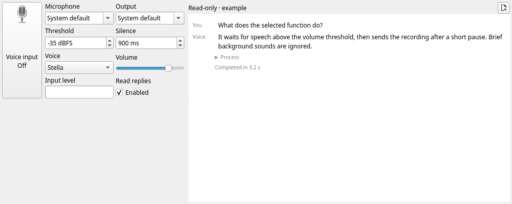

# Kate Voice Panel

## Overview

A read-only voice companion for Kate, powered by DeepSeek Harness (DSH).
Ask about the code under the cursor while continuing to read or navigate the editor.
Replies are brief, lightly formatted, and optionally spoken aloud.

- A large voice switch and eight settings in a fixed four-row, two-column layout.
  The controls occupy less than half the panel; only the transcript scrolls.
- Local volume detection starts an utterance; a pause sends it automatically.
  Listening pauses during processing and playback to avoid feedback.
- Automatic cursor, selection, unsaved active-file excerpt, and open-file context.
- Workspace reading, directory exploration, sandboxed Bash, and DeepSeek web search/fetch.
- Fixed `deepseek-flash` reasoning with `max` effort. Speech and web tools use
  DeepSeek's current service endpoints, without pinning separate model versions.
- Clickable file references, rendered mathematics, folded tool details, and elapsed time.

## Screenshot



The screenshot uses an example conversation in the actual panel.

## Requirements

Linux with PipeWire, Kate/Qt 6, KDE Frameworks 6, Node.js 24.5+, `dsh`, and
`bubblewrap`. The plugin does not install agent packages or change DSH configuration.
Install DSH separately using its [official instructions](https://github.com/deepseek-ai/deepseek-harness).
The DSH SDK composition is tested with `@deepseek-ai/dsh` 0.2.2-rc.1.

Set `DEEPSEEK_API_KEY` in Kate's environment or in `~/.dsh/.env`:

```dotenv
DEEPSEEK_API_KEY=your-api-key
```

Environment variables take precedence over the file. `DSH_HOME` selects another
DSH home. HTTP(S) proxy variables are supported; an HTTP(S) `ALL_PROXY` is also
accepted. SOCKS proxies are not supported. Kate must inherit `node` and `dsh` on
`PATH`; `KATE_VOICE_NODE` can specify an absolute Node executable.

## Build

Install Fedora dependencies:

```sh
sudo dnf install kate git ripgrep gcc-c++ cmake ninja-build extra-cmake-modules \
  qt6-qtbase-devel qt6-qtwebengine-devel qt6-qtwebchannel-devel \
  kf6-ktexteditor-devel kf6-kcoreaddons-devel kf6-kxmlgui-devel kf6-ki18n-devel \
  nodejs pipewire-utils bubblewrap
```

From the project directory:

```sh
cmake -S . -B build -G Ninja \
  -DCMAKE_BUILD_TYPE=Release -DBUILD_TESTING=OFF \
  -DCMAKE_INSTALL_PREFIX="$HOME/.local" \
  -DKDE_INSTALL_PLUGINDIR=lib/qt6/plugins
cmake --build build --parallel 4
```

Build against the Qt/KDE libraries used by your installed Kate. To try the build
without installing it, run `scripts/run-dev.sh`.

## Install

```sh
cmake --install build
QT_PLUGIN_PATH="$HOME/.local/lib/qt6/plugins${QT_PLUGIN_PATH:+:$QT_PLUGIN_PATH}" kate --new
```

Enable **Voice Panel** in **Settings > Configure Kate > Plugins**. Open the bottom
**Voice** tab or use **Tools > Show Voice Panel**. Assign a shortcut in Kate's
**Configure Keyboard Shortcuts** dialog if desired. Installation creates the required directories.
To uninstall, close Kate and remove
`~/.local/lib/qt6/plugins/kf6/ktexteditor/katevoicepanel.so`.

## Usage

Turn **Voice input** on, speak, then pause. The default trigger is −35 dBFS with
900 ms of silence before sending. Lower thresholds detect quieter voices. Sounds
shorter than 200 ms are discarded; utterances are bounded to 110 seconds. This is
volume detection, not a wake-word or speech-classification model.

Choose the microphone, output, Stella/Tide voice, playback volume, and whether to
read replies aloud. Audio devices follow the system default unless explicitly set.
Settings persist; the microphone starts off when a new panel instance is created.

**Hiding the panel keeps listening enabled.** Esc returns to the editor; the panel
also hides automatically if it becomes shorter than the controls require. Turn the
voice switch off to cancel listening, processing, and playback. Disabling the plugin
or exiting Kate also stops its processes. Use **New conversation** to clear the chat.

Context is captured when speech begins. The workspace is Kate's active project,
the active file's directory, or HOME. Changing workspace starts a fresh DSH session.
Large context is bounded and marked as truncated. Follow-up questions share the
current DSH session. Resetting, changing workspace, or cancelling an active turn
starts a fresh session; pausing idle input preserves it. Transcript history is kept
only for the current panel instance.

## Read-only behavior

The system prompt limits the assistant to explanation, and the runtime exposes only
five tools: `read_file`, `list_directory`, `bash`, `web_search`, and `web_fetch`.
File tools reject paths outside the workspace. Bash sees the workspace mounted
read-only at `/workspace`, a private temporary directory, and no network or inherited
credentials. It fails closed when Bubblewrap is unavailable. No write/edit, MCP,
approval, or package-management tools are mounted.

Recordings and the isolated DSH profile live in private temporary directories and
are removed when the panel is destroyed. Audio, editor context, requested file
content, and web queries are sent to DeepSeek. Background sound is kept locally
until an utterance meets the trigger and pause conditions.

## Tests

```sh
sudo dnf install python3 xorg-x11-server-Xvfb xorg-x11-xauth
scripts/test.sh
```

Normal tests use protocol and audio fixtures without API calls or microphone access.
See [testing](docs/testing.md) for live validation and coverage.

## Architecture and reuse

The native Kate plugin captures context, detects voice activity, and controls
PipeWire. A dependency-free Node bridge calls DeepSeek ASR/TTS and a temporary DSH
SDK runtime. The transcript is offline HTML connected through a small Qt WebChannel.

File-link parsing, Markdown/KaTeX rendering, native theme handling, and plugin lifecycle
patterns are reused from [Kate Agent Panel](https://github.com/gtg2619/kate-agent-panel).
Both plugins can be loaded together; their IDs, resources, and shortcuts are separate.

API references: [ASR](https://api-docs.deepseek.com/guides/asr/),
[TTS](https://api-docs.deepseek.com/guides/tts/),
[search and fetch](https://api-docs.deepseek.com/guides/search/).

## License

MIT. Reused Agent Panel code and bundled rendering libraries retain their licenses.
